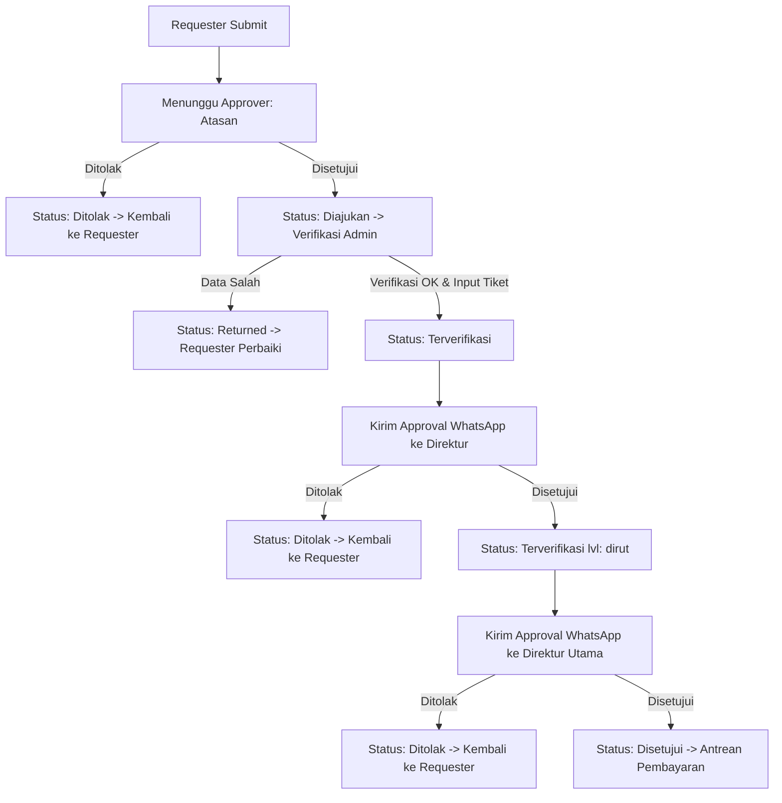

# Kelana: Alur Bisnis, Transisi Status & Rantai Persetujuan (Business Flow)

Dokumen ini adalah acuan resmi logika bisnis, rantai persetujuan, kalkulasi pelacak 9-tahap, dan mekanisme keamanan token untuk sistem **Kelana**. Seluruh kode backend (Laravel) dan frontend (React) wajib patuh pada spesifikasi di dokumen ini.

---

## 1. Pelacak 9 Tahap (Stage Tracker)

Admin travel memiliki komponen pelacak 9 tahap (*Stage Tracker*) pada setiap pengajuan untuk mengetahui secara instan posisi pengajuan saat ini dan siapa yang bertindak selanjutnya.

> [!IMPORTANT]
> **Prinsip Arsitektur Database**: Tahap pelacak (stage 1 s/d 9) **TIDAK DISIMPAN** sebagai kolom tersendiri di tabel database. Nilai tahap dihitung secara dinamis (*computed/derived property*) dari kombinasi kolom `status` dan `approval_level` saat ini.

### 9 Tahap Pelacak Resmi

1. **Pengajuan**: Pengajuan awal dibuat oleh Requester.
2. **Atasan**: Pengajuan menunggu persetujuan dari Atasan langsung.
3. **Verifikasi Admin**: Pemeriksaan kelengkapan data oleh Admin Travel.
4. **Pilih Tiket**: Admin Travel menginput opsi tiket, jadwal riil, dan harga tiket secara manual.
5. **Direktur**: Pengajuan menunggu persetujuan tahap kedua oleh Direktur.
6. **Direktur Utama**: Pengajuan menunggu persetujuan tahap ketiga oleh Direktur Utama.
7. **Pembayaran**: Pemrosesan pembayaran tiket via Transfer (Finance) atau Corporate Credit Card (Admin).
8. **Tiket Terbit**: Tiket telah dibayar, admin menerbitkan PNR, E-ticket, dan Ticket Receipt.
9. **Selesai**: Perjalanan telah selesai, dokumen diarsipkan ke Reports & Archive.

### Logika & Rumus Kalkulasi Tahap

```php
/**
 * Menghitung tahap pelacak (1-9), teks status, dan langkah berikutnya.
 *
 * @param string $status        Nilai enum TravelRequestStatus
 * @param string|null $level    Nilai enum ApprovalLevel ('atasan', 'direktur', 'dirut')
 * @param array|null $payment   Metadata pembayaran (tipe, status penerimaan dana)
 * @return array{stage: int, text: string, next_action: string, is_error: bool}
 */
function calculateStage(string $status, ?string $level = null, ?array $payment = null): array
{
    return match ($status) {
        'Diajukan' => [
            'stage' => 3,
            'text' => 'Menunggu verifikasi data admin',
            'next_action' => 'Admin memeriksa kelengkapan data pengajuan',
            'is_error' => false,
        ],
        'Returned' => [
            'stage' => 3,
            'text' => 'Dikembalikan ke requester untuk diperbaiki',
            'next_action' => 'Requester memperbaiki data pengajuan',
            'is_error' => true,
        ],
        'Terverifikasi' => match ($level) {
            'direktur' => [
                'stage' => 5,
                'text' => 'Tiket terverifikasi, siap dikirim ke Direktur',
                'next_action' => 'Admin mengirim tautan approval WhatsApp ke Direktur',
                'is_error' => false,
            ],
            'dirut' => [
                'stage' => 6,
                'text' => 'Disetujui Direktur, siap dikirim ke Direktur Utama',
                'next_action' => 'Admin mengirim tautan approval WhatsApp ke Direktur Utama',
                'is_error' => false,
            ],
            default => [
                'stage' => 4,
                'text' => 'Admin mencari dan menginput tiket riil',
                'next_action' => 'Admin menginput jadwal riil dan harga via modal',
                'is_error' => false,
            ],
        },
        'Menunggu Approver' => match ($level) {
            'direktur' => [
                'stage' => 5,
                'text' => 'Menunggu persetujuan Direktur',
                'next_action' => 'Direktur login dan memutuskan approve/reject',
                'is_error' => false,
            ],
            'dirut' => [
                'stage' => 6,
                'text' => 'Menunggu persetujuan Direktur Utama',
                'next_action' => 'Direktur Utama login dan memutuskan approve/reject',
                'is_error' => false,
            ],
            default => [
                'stage' => 2,
                'text' => 'Menunggu persetujuan Atasan Langsung',
                'next_action' => 'Atasan login dan memutuskan approve/reject',
                'is_error' => false,
            ],
        },
        'Ditolak' => [
            'stage' => match ($level) {
                'direktur' => 5,
                'dirut' => 6,
                default => 2,
            },
            'text' => 'Pengajuan ditolak oleh approver',
            'next_action' => 'Requester memperbaiki pengajuan atau membatalkan',
            'is_error' => true,
        ],
        'Disetujui' => [
            'stage' => 7,
            'text' => 'Disetujui seluruh jajaran approver',
            'next_action' => 'Admin memilih metode pembayaran (TF atau CC)',
            'is_error' => false,
        ],
        'Menunggu Finance' => [
            'stage' => 7,
            'text' => ($payment['dana_diterima'] ?? false)
                ? 'Dana transfer telah diterima finance'
                : 'Menunggu transfer dana dari finance',
            'next_action' => ($payment['dana_diterima'] ?? false)
                ? 'Admin/Finance mencatat pembayaran tiket selesai'
                : 'Finance memproses dan mencatat penerimaan dana',
            'is_error' => false,
        ],
        'Sudah Dibayar' => [
            'stage' => 8,
            'text' => 'Pembayaran selesai, tiket belum diterbitkan',
            'next_action' => 'Admin mengunggah PNR, E-ticket, dan Ticket Receipt',
            'is_error' => false,
        ],
        'Tiket Diterbitkan' => [
            'stage' => 8,
            'text' => 'Tiket resmi telah diterbitkan',
            'next_action' => 'Admin menandai Selesai setelah perjalanan terlaksana',
            'is_error' => false,
        ],
        'Selesai' => [
            'stage' => 9,
            'text' => 'Perjalanan dinas selesai (diarsipkan)',
            'next_action' => 'Tidak ada tindakan lanjutan',
            'is_error' => false,
        ],
        'Batal' => [
            'stage' => 9,
            'text' => 'Pengajuan dibatalkan sebelum pembayaran',
            'next_action' => 'Tidak ada tindakan lanjutan',
            'is_error' => true,
        ],
        'Refund' => [
            'stage' => 9,
            'text' => 'Pengajuan dibatalkan setelah bayar (proses refund)',
            'next_action' => 'Finance memproses refund di luar sistem, admin mencatat',
            'is_error' => true,
        ],
        default => [
            'stage' => 1,
            'text' => 'Draf pengajuan',
            'next_action' => 'Requester melengkapi data formulir',
            'is_error' => false,
        ],
    };
}
```

---

## 2. Rantai Persetujuan Berjenjang (Hierarchical Approval Chain)

Alur persetujuan mengikuti hierarki tetap yang tidak dapat dilompati:



### Aturan Khusus Penolakan & Koreksi Harga

1. **Penolakan Direktur / Direktur Utama**:
   * Jika Direktur atau Direktur Utama menolak, status berubah menjadi `Ditolak`.
   * Berkas **langsung dikembalikan ke Requester** untuk diperbaiki atau dibatalkan, bukan berhenti di admin.
2. **Koreksi Harga Setelah Disetujui (Re-Approval Rantai Penuh)**:
   * Jika tiket yang telah disetujui mengalami perubahan harga riil dari maskapai/penyedia tiket sebelum diterbitkan, admin wajib menginput harga koreksi.
   * Perubahan harga ini membatalkan persetujuan sebelumnya dan memicu **persetujuan ulang (re-approval)** secara berjenjang dari awal rantai:
     $$\text{Atasan Requester} \longrightarrow \text{Direktur} \longrightarrow \text{Direktur Utama}$$
   * Alur:
     1. Admin menginput koreksi harga riil pada sistem.
     2. Status berubah kembali ke `Menunggu Approver` dengan level `atasan`.
     3. Tautan approval baru dibuat dan dikirim ke Atasan Requester.
     4. Setelah Atasan menyetujui, admin mengirim approval ke Direktur.
     5. Setelah Direktur menyetujui, admin mengirim approval ke Direktur Utama.
     6. Setelah Direktur Utama menyetujui, status kembali ke `Disetujui` dan masuk ke antrean pembayaran dengan nilai harga terbaru.

---

## 3. Spesifikasi Keamanan Token Approval WhatsApp

Tautan approval yang dikirimkan melalui WhatsApp (`wa.me`) tunduk pada standar keamanan tingkat tinggi berikut:

1. **Format Tautan**:
   Tautan dibuat oleh `WhatsAppLinkService` dengan format:
   ```text
   https://kelana.aldzama.com/approval/action?token={plain_token}
   ```
2. **Karakteristik Token**:
   * Dibuat menggunakan string acak kriptografis 64 karakter (`bin2hex(random_bytes(32))`).
   * **Penyimpanan di Database**: Token **WAJIB DISIMPAN DALAM BENTUK HASH SHA-256** (`hash('sha256', $plainToken)`). Plaintext token tidak boleh disimpan di tabel.
   * **Masa Berlaku (TTL)**: Tepat **48 jam** sejak dibuat (diatur melalui `config/kelana.php`).
   * **Sifat Token**: **Sekali pakai (single-use)** untuk tahap yang bersangkutan.
3. **Pemisahan GET dan POST (Non-Destructive GET)**:
   * **Permintaan HTTP GET**: Hanya memvalidasi keberadaan token hash yang valid dan belum expired, lalu menyajikan data ringkasan pengajuan perjalanan. **GET TIDAK BOLEH MENGUBAH STATUS ATAU MENGONSUMSI TOKEN.**
   * **Permintaan HTTP POST**: Melakukan aksi persetujuan (`approve`) atau penolakan (`reject` beserta alasan).
4. **Validasi Otorisasi Approver**:
   * Approver wajib dalam keadaan login (autentikasi internal).
   * Pada saat POST dilakukan, server memeriksa apakah `auth()->id()` cocok dengan `target_approver_id` yang tercatat pada token. Jika tidak cocok, request ditolak dengan kode respons `403 Forbidden`.
5. **Invalidasi Otomatis (Stale Invalidation)**:
   * Token otomatis hangus/tidak berlaku jika status pengajuan sudah bergeser (misalnya requester sudah menarik/memperbaiki pengajuan, atau admin telah melakukan koreksi jadwal).

---

## 4. Mekanisme Pembatalan (Cancel) & Reschedule

### Hak Pengajuan Cancel & Reschedule
* **Pengusul**: Baik **Requester** maupun **Admin Travel** berhak mengajukan permohonan pembatalan (*cancel*) atau penjadwalan ulang (*reschedule*).
* **Alasan Wajib**: Setiap pengajuan cancel atau reschedule wajib menyertakan alasan tertulis yang jelas.

### Rantai Persetujuan Fleksibel (Mengikuti Riwayat Approver yang Dicapai)
Rantai approver untuk permohonan cancel atau reschedule mengikuti tingkatan approver yang **sudah pernah dicapai** oleh pengajuan tersebut:
* Jika pengajuan baru mencapai **Atasan**: Persetujuan cancel/reschedule hanya diajukan ke **Atasan**.
* Jika pengajuan telah disetujui Atasan dan mencapai **Direktur**: Persetujuan cancel/reschedule diajukan ke **Atasan → Direktur**.
* Jika pengajuan telah mencapai **Direktur Utama**, berstatus `Disetujui`, atau sudah dalam tahap pembayaran/penerbitan tiket: Rantai persetujuan cancel/reschedule melibatkan **Atasan → Direktur → Direktur Utama**.

### Dampak Status Pembatalan (Cancel)
1. **Cancel Sebelum Pembayaran (`Batal`)**:
   * Jika permohonan cancel disetujui *sebelum* tiket dibayar (status pengajuan saat ini: `Diajukan`, `Terverifikasi`, `Menunggu Approver`, `Disetujui`, atau `Menunggu Finance` sebelum dana dibayarkan), status akhir otomatis berubah menjadi **`Batal`**.
   * Pengajuan ditutup dan tidak ada proses pengembalian dana keuangan.
2. **Cancel Setelah Pembayaran (`Refund`)**:
   * Jika permohonan cancel disetujui *setelah* pembayaran tiket dilakukan (status pengajuan saat ini: `Sudah Dibayar` atau `Tiket Diterbitkan`), status akhir berubah menjadi **`Refund`**.
   * Proses refund dana riil dilakukan oleh tim Finance di luar sistem sesuai kebijakan maskapai/penyedia.
   * Admin Travel mencatat nomor referensi refund, nominal pengembalian, dan mengunggah bukti refund di sistem, kemudian menandai pengajuan sebagai `Selesai`.

### Dampak Status Penjadwalan Ulang (Reschedule)
* Requester atau Admin mengajukan reschedule dengan memilih tanggal keberangkatan baru dan menyertakan alasan wajib.
* Permohonan reschedule diproses melalui rantai approver yang telah dicapai pengajuan.
* Setelah seluruh approver terkait menyetujui permohonan reschedule, status pengajuan otomatis **kembali ke `Terverifikasi`** dengan tanggal baru.
* Admin Travel kemudian mencari dan menginput jadwal/tiket baru via modal input tiket manual, dan alur berlanjut sesuai siklus tiket yang telah diperbarui.

---

## 5. Sumber Tiket & Antarmuka Adapter

Sistem menggunakan prinsip *Loose Coupling* dengan arsitektur adapter:

1. **Kontrak Adapter**: `app/Contracts/TicketSourceAdapterInterface.php`
2. **Implementasi Tahap Awal**: `app/Services/Ticket/ManualTicketSource.php`
   * Menerima input modal dari Admin Travel: Nama Maskapai/Penyedia, Kode Penerbangan/Armada, Jam Berangkat, Jam Tiba, dan Harga Riil per Penumpang.
   * Mencatat `user_id` admin yang menginput dan timestamp pencatatan untuk keperluan audit.
3. **Kesiapan Masa Depan**: Jika integrasi API tiket eksternal atau scraper resmi telah ditentukan, pengembang cukup menambahkan implementasi adapter baru (misal `ScraperTicketSource.php`) tanpa merusak alur verifikasi tiket yang sudah ada.

---

## 6. Penanganan Lampiran KTP & Berkas Privat

* **Penyimpanan**: Seluruh file foto/scan KTP penumpang disimpan di disk privat Laravel:
  ```text
  storage/app/private/ktp/{request_id}/{passenger_id}_{hash}.{ext}
  ```
* **Akses Terotorisasi**: File KTP **TIDAK PERNAH DISIMPAN** di folder `public/` atau di-symlink ke web root.
* **Endpoint Unduh Terproteksi**: File KTP hanya dapat diunduh melalui rute:
  ```http
  GET /api/v1/travel-requests/{travelRequest}/passengers/{passenger}/ktp
  ```
  Endpoint ini dilindungi oleh `TravelRequestPolicy`, memastikan hanya Requester pemilik pengajuan, Atasan langsung yang ditugaskan, Admin Travel, Direksi, dan Superadmin yang berhak mengakses file KTP.

---

## 7. Layanan Dokumen PDF (`PdfDocumentService`)

* **Layanan Backend**: `app/Services/Document/PdfDocumentService.php`.
* **Template Tampilan**: Disimpan di `resources/views/pdf/`
  * `travel-request.blade.php`: Dokumen cetak formulir pengajuan perjalanan dinas.
  * `ticket-summary.blade.php`: Dokumen rangkuman tiket dan e-ticket receipt.
* **Kop Surat Perusahaan**: Ditandai secara eksplisit dengan komentar dan elemen `placeholder` standar hingga file template resmi (`template.docx`) dan contoh (`contoh-ticket-booking.pdf`) difinalisasi menjadi aset produksi.

---

## 8. Persyaratan Pengujian Otomatis (Automated Tests)

Sebelum kode dinyatakan selesai dan siap dideploy, rangkaian pengujian otomatis berikut **wajib diimplementasikan dan lolos (PASS)**:

1. **Uji Token Sekali Pakai (Single-Use)**: Memastikan token approval yang telah berhasil mengeksekusi POST `approve` tidak dapat digunakan kembali.
2. **Uji Kedaluwarsa 48 Jam**: Memastikan token yang telah berusia lebih dari 48 jam menghasilkan respons `ApprovalTokenExpiredException` (HTTP 410 / 422).
3. **Uji Invalidasi Perubahan Status (Stale Token)**: Memastikan token tidak dapat digunakan jika status pengajuan sudah bergeser sebelum token dieksekusi.
4. **Uji Penolakan Approver Tidak Sah**: Memastikan jika User B mencoba mengeksekusi token yang ditujukan untuk User A, request ditolak dengan `403 Forbidden`.
5. **Uji Non-Destructive GET**: Memastikan akses berulang kali ke URL token via method GET tidak mengubah status pengajuan dan tidak menghanguskan token.
6. **Uji Validasi NIK & KTP**: Memastikan pengajuan dengan NIK kurang/lebih dari 16 digit atau tanpa lampiran KTP ditolak dengan HTTP 422.

